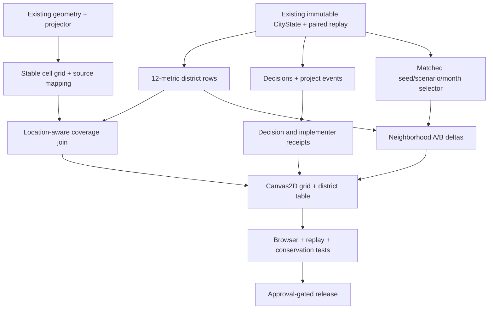

> **Archive notice (2026-11-11):** This is the exact earlier 30-task proposal recovered from the user's project files. Its source-main SHA, WIP branch assumptions, screenshot coverage, implementation status and named file targets were historical hypotheses. Use [docs/demo-backlog.md](../demo-backlog.md) for the active queue and the NB-* triage IDs. Nothing in this file authorizes release, new core models or auto-starting workers.

# HappyBearLandia — Continuous Codex Implementation Backlog

> **Status:** proposed / not yet committed. **Source main:** `6dd2dd9b8022` (verified 2026-11-11). **Target:** one authoritative monthly CityState, neighborhood metrics, evidence-backed decision/implementation trace, and a synchronized A/B grid map for 120 months. This file is a rolling queue, **not** a claim that the new tasks already exist.
>
> **Current WIP caution:** `fix/first-run-routes-bars-lite-renderer` contains unmerged, unverified fixes from the preceding work. Treat it as candidate code, not released functionality; task R01 inventories and tests it. No merge or deployment is implied here.

## Running the pipeline (read this first)

1. Start at the verified `main` commit and read `AGENTS.md`, `docs/design.md`, `docs/implementation-plan.md` and module docs. Use **seven separate Codex threads/worktrees** when available: six feature workers plus an integration/verification coordinator (respect repo `AGENTS.md` limits on parallel agents). Each task is small: **XS = 15–30 minutes, S = 30–60 minutes, M = split or reserve a second iteration**. If a task exceeds 60 minutes, deliver its smallest tested vertical slice and split the remainder.
2. At most **one task per thread** and only select tasks with **all dependencies merged**. Never edit one another's owned files. The integration coordinator owns shared `server.js`, `world/render.js`, `world/causal/page.js`, entry-point HTML and CI.
3. Every thread finishes with: changed files, real code + tests, fixture/provenance, focused command and observed result, UI route when applicable, commit SHA, and blockers. **A design-only patch does not count as done.**
4. Coordinator runs focused tests after each merge/cherry-pick, then browser and accessibility tests for the integrated slice. Do not merge failing branches or alter production data. Production deployment needs explicit approval.
5. Keep this exact backlog current with checkboxes/statuses, do not regenerate it wholesale. Promote the next unblocked tasks whenever the previous wave completes. Use statuses `ready`, `in-progress`, `blocked`, `needs-image-labels`, `in-review`, `done`, or `rejected`.

## Nonnegotiable evidence rules

- The monthly **`CityState.v1`/`city-systems.1.0.0`** model in [`world/city/contracts.js`](https://github.com/adnanwahab/happybearlandia/blob/main/world/city/contracts.js) and [`world/city/engine.js`](https://github.com/adnanwahab/happybearlandia/blob/main/world/city/engine.js) is the authority for this project. Population-v2, classic World, House, and Decision Studio are separate clocks/identities until an explicit supported mapping exists.
- Existing work to reuse: `createEngine`, `cityMetrics`, `CityStore`, `districtHeatmap` in `world/causal/heatmap.js`, `mountCityHeatmap`, existing Time Machine in `world/causal/page.js`, **`POST /api/experiments/:city_id/replay`** from `world/city/api.js`, and saved `observations`, `system_events`, `decisions`, `moves`, `trips`, `utility_state`, and `projects` in `world/city/storage.js`. **Do not assume there is a neighborhood-grid API.** All paths marked `(NEW)` below are proposals to create, not current repository files.
- City model `districtId` is an existing **synthetic or model-assigned district**, not necessarily an observed city-neighborhood boundary. An OSM building footprint does **not** prove who lives, works, manages, or makes policy inside it. No per-cell policy or economic values can be allocated from district averages without defensible source location attribution.
- Numeric **0**, unknown **null**, not-modeled, and deliberately unavailable are four different states. Every metric needs units, denominator, coverage, simulation month, model/source provenance and city/district/cell scope. If a metric is only known by district, label it **district context** on the grid rather than inventing per-cell precision.
- `step.decisions` currently records `actorType`/`actorId` (including modeled parcel or system actors), `step.events` records event types/geographies, and `projects` contains stage data. **It does not automatically identify a human decision-maker or work crew.** Track explicitly recorded model entities; show unknown executor where no assignment exists. Never name real people without a verified source.
- Maintain accessibility and Canvas2D rendering for the grid itself; no WebGPU requirement for viewing 12 metric layers. A/B means **same initial model, same seed/index/version/month, one supported intervention changed**. A chart or heatmap is not a causal forecast beyond the modeled rules.

## The 12-neighborhood-metric gate — provisional, grounded in existing City fields

**Screenshot limitation:** The exact twelve labels in the accompanying image were not available to this session as readable image content. **Do not assert these are the image's twelve labels.** The following is a **provisional, implementable 12-field catalog grounded in current `CityState`**. M05 is a blocking reconciliation gate for calling the image requirement complete. If the image calls for variables not modeled in City (for example crime, air pollution or life satisfaction), record `status: not_modeled` rather than substituting an unrelated proxy.

| Provisional metric ID | Neighborhood value / calculation | Unit & aggregation | Verified model source | Data caveat |
|---|---|---|---|---|
| `population` | Sum household `size` by district | persons · sum | `state.households[].size`, `.districtId` | Synthetic persons, not census |
| `households` | Number of households | households · count | `state.households[].districtId` | No real addresses implied |
| `housing_units` | Number of housing units | units · count | `state.units[].districtId` | May include under construction/renovation |
| `available_units` | Units with `status === 'available'` | units · count | `state.units[].status` | Available ≠ affordable |
| `mean_rental_unit_rent` | Mean `rent` for rental-tenure units only | synthetic USD/month · mean | `state.units[].rent`, `.tenure` | Missing if no rental units; not market-observed |
| `unhoused_households` | Households with no `unitId` | households · count | `state.households[].unitId` | **Not** a real-world homelessness census |
| `employed_workers` | Workers with a non-null `jobId` | workers · count | `state.workers[].jobId` | Synthetic assignments; not employment rate |
| `unfilled_jobs` | Jobs without assigned `workerId` | positions · count | `state.jobs[].workerId` | May not represent job vacancies in reality |
| `open_businesses` | Businesses with `status === 'open'` | businesses · count | `state.businesses[].status` | Synthetic establishment statuses |
| `outgoing_link_travel_time` | Mean recorded `travelTime` of outgoing links from district (`from`) | modeled minutes · mean | `state.links[].from`, `.travelTime` | **Not** person commute times; empty links → null |
| `overloaded_facilities` | Facilities with `utilization > 1` | facilities · count | `state.facilities[].utilization` | Illustrative service-load estimate |
| `utility_shortfalls` | Utilities with `serviceLevel < 1` | networks · count | `state.utilities[].serviceLevel` | Count of affected network records, not people without power |

For every row store: `runId, scenarioId, runIndex, month, modelVersion, geographyType, geographyId, metricId, value|null, unit, numerator|null, denominator|null, sampleCount, coverage, status, provenance`. Cell-level rows additionally require `cellId` and `locationBasis: exact-source-geometry | modeled-geometry | unavailable`. Changes to registry IDs require schema versioning and fixtures.

**Physical grid mapping:** Start with a stable square grid in local projected meters, keyed by world revision/origin and resolution. Use existing `projector(origin)` from `world/gen.js`; use exact sourced OSM polygons/IDs where available. Show colored **cells only when underlying entity-level data supports cell attribution**. Any district-only metric is shown in the linked district summary with `cellValue: null`; optionally tint a district outline as context, not individual cells as if measured.

## Architecture: seven independent lanes with one integration contract

## Launch queue — the **seven best independent tasks right now**

All seven have `Depends: none`. Each worker owns a different proposed module or nonoverlapping QA/documentation scope. Start concurrently; do not wait for other tasks to finish. **Integration coordinator does not write into another worker's owned module.**

| Codex thread | Pick | Why now | Exclusive first-wave scope |
|---|---|---|---|
| 1 · Metrics | **M01** | Unblocks every neighborhood measurement | new metric catalog + pure tests |
| 2 · Geography | **G01** | Provides stable grid identity without making metrics up | new grid-coordinate helper + tests |
| 3 · Attribution | **P01** | Establishes evidence and actor/implementer boundaries | new decision normalizer + tests |
| 4 · Futures | **F01** | Formalizes seed-matched A/B run pairs | new pair selector + tests |
| 5 · UI | **U01** | Immediately produces a visible keyboard-accessible grid shell | new Canvas2D panel and fixture tests |
| 6 · Verification | **R01** | Prevents earlier unfinished bug fixes from being silently lost | branch/test inventory only |
| 7 · Coordinator | **O01** | Pins source SHA, storage and release gates | docs-only readiness record |

**After wave 1:** immediately pick M02, G02, P02, F02 (after M02), U02 (after M02+G03), R02, O02 when their listed dependencies truly land; do **not** force seven artificial jobs when the DAG has fewer ready tasks.

## Workstreams and implementation cards (exactly 30)

### M — Metric contracts and neighborhood measurements

**Ownership:** new `world/city/` pure modules; read existing `world/city/contracts.js`, `world/city/engine.js`, `world/city/systems.js`, `world/causal/heatmap.js`.

#### M01 — Catalog 12 canonical district metrics

- **Status:** `ready` · **Size:** `XS` · **Depends:** none
- **Owned files:** `world/city/neighborhood-metrics.js (NEW; pure); test/neighborhood-metrics.test.js (NEW)`
- **Implementation:** Implement the provisional twelve-source-field registry below; each entry declares exact unit, reducer, denominator, and evidence class. Do NOT claim the provisional labels match the attached image.
- **Acceptance:** Registry exposes exactly 12 stable IDs and rejects duplicates.; No nonexistent data source gets a numeric value; unrecognized image labels remain a release blocker.; Unit test verifies source paths against a minimal valid `CityState.v1` fixture..
- **Done evidence:** add commit SHA, test command/result and screenshot/route if UI.

#### M02 — Compute all 12 metrics for every City district

- **Status:** `blocked` · **Size:** `S` · **Depends:** `M01`
- **Owned files:** `world/city/neighborhood-metrics.js (NEW extension); test/neighborhood-metrics.test.js`
- **Implementation:** Aggregate from `CityState.v1` by `districtId` (and by outgoing link origin for travel) without replacing missing values with zero.
- **Acceptance:** One output row per district × 12 metrics, even for empty districts; missing means null plus reason.; Population and jobs counts reconcile to city-wide totals where their partition is complete.; Rental mean excludes non-rental units and returns null for denominator zero..
- **Done evidence:** add commit SHA, test command/result and screenshot/route if UI.

#### M03 — Create 120-month neighborhood time series

- **Status:** `blocked` · **Size:** `S` · **Depends:** `M02`
- **Owned files:** `world/city/neighborhood-series.js (NEW); test/neighborhood-series.test.js (NEW)`
- **Implementation:** Transform existing replay `steps[].state` into bounded monthly district values, preserving run index, scenario ID and model version.
- **Acceptance:** Supports month 0 if supplied and months 1–120 without interpolation.; Checks identity and month monotonicity, and refuses mismatched run/model inputs.; A repeated same-seed replay generates an identical series hash..
- **Done evidence:** add commit SHA, test command/result and screenshot/route if UI.

#### M04 — Add explicit metric coverage & data quality

- **Status:** `blocked` · **Size:** `XS` · **Depends:** `M02`
- **Owned files:** `world/city/neighborhood-coverage.js (NEW); test/neighborhood-coverage.test.js (NEW)`
- **Implementation:** For every value track sample count, denominator, source coverage, and missing/unlocatable reasons.
- **Acceptance:** A numeric zero and unavailable/null produce different statuses.; A district with no rental units shows mean rent unavailable, not $0.; No default confidence scores or fake sample sizes..
- **Done evidence:** add commit SHA, test command/result and screenshot/route if UI.

#### M05 — Reconcile metric names with the provided screenshot

- **Status:** `needs-image-labels` · **Size:** `XS` · **Depends:** `M01`
- **Owned files:** `world/city/neighborhood-metrics.js and docs/backlog.md metric appendix`
- **Implementation:** Replace provisional aliases only after the twelve exact screenshot labels/units are supplied and verified against actual model signals.
- **Acceptance:** All twelve screenshot labels matched 1:1 to supported metric IDs or explicitly marked unsupported.; Unsupported variables stay visible as unavailable rather than receiving a proxy.; No acceptance claim that the screenshot was read when it was not..
- **Done evidence:** add commit SHA, test command/result and screenshot/route if UI.

### G — Spatial grid and provenance

**Ownership:** new `world/reality/` geometry helpers; read `world/reality/geography.js`, `world/gen.js`, `world/reality/diff-radar.js`.

#### G01 — Create stable local-coordinate square-grid keys

- **Status:** `ready` · **Size:** `XS` · **Depends:** none
- **Owned files:** `world/reality/grid-lattice.js (NEW); test/grid-lattice.test.js (NEW)`
- **Implementation:** Use existing `projector(origin)` from `world/gen.js`; define bounded grid size and deterministic cell ID from origin/revision/resolution/row/column.
- **Acceptance:** Same source coordinates and grid metadata give identical cell IDs.; Point-on-boundary tie rule is deterministic, with tests for negative coordinates and origin changes.; A grid contains no metric values or invented neighborhoods..
- **Done evidence:** add commit SHA, test command/result and screenshot/route if UI.

#### G02 — Map exact OSM buildings and parcel footprints into cells

- **Status:** `blocked` · **Size:** `S` · **Depends:** `G01`
- **Owned files:** `world/reality/grid-entity-map.js (NEW); test/grid-entity-map.test.js (NEW)`
- **Implementation:** Use only verified stored footprints/IDs; preserve `sourceId` links and record multi-cell overlap or unknown geometry.
- **Acceptance:** Deterministic exact geometry intersection or declared centroid policy is tested.; Unmapped building stays unlocated; no nearest-neighbor invention.; One physical building is counted once for entity totals even when drawn in several cells..
- **Done evidence:** add commit SHA, test command/result and screenshot/route if UI.

#### G03 — Build district-to-cell coverage crosswalk

- **Status:** `blocked` · **Size:** `S` · **Depends:** `G01`, `G02`, `M02`
- **Owned files:** `world/reality/grid-crosswalk.js (NEW); test/grid-crosswalk.test.js (NEW)`
- **Implementation:** Track which buildings/households/units have defensible cell locations; preserve district-only metrics as district context when cell attribution is unavailable.
- **Acceptance:** Every cell displays a coverage numerator/denominator and a source/missing label.; A district aggregate is not copied into all its cells as if cell-level fact.; Out-of-bound entities remain in an unlocated bucket and reconcile to input counts..
- **Done evidence:** add commit SHA, test command/result and screenshot/route if UI.

#### G04 — Add stable multi-resolution grid aggregation

- **Status:** `blocked` · **Size:** `S` · **Depends:** `G03`
- **Owned files:** `world/reality/grid-resolution.js (NEW); test/grid-resolution.test.js (NEW)`
- **Implementation:** Derive coarse cells from finest supported source rows and preserve consistent totals; use different aggregation methods for count/mean/rate.
- **Acceptance:** Parent counts equal sums of child counts where coverage is complete.; Means use numerator/denominator, not unweighted mean of cell means.; Unknown values remain explicitly unknown across zoom..
- **Done evidence:** add commit SHA, test command/result and screenshot/route if UI.

### P — Decision-makers, projects and implementers

**Ownership:** new `world/city/` attribution modules; read `world/city/engine.js`, `world/city/systems.js`, `world/city/storage.js`.

#### P01 — Normalize existing decision-event references

- **Status:** `ready` · **Size:** `XS` · **Depends:** none
- **Owned files:** `world/city/decision-attribution.js (NEW); test/decision-attribution.test.js (NEW)`
- **Implementation:** Adapt `step.decisions` and `step.events` to an explicit trace schema with model actor type/id, geography, project/policy reference when present, and source event IDs.
- **Acceptance:** Preserves `actorType`, `actorId`, `modelId`, `modelVersion`, `simulationTime` exactly.; A parcel deciding to develop is NOT relabeled as a building or a human office.; No implementer person is populated without an actual recorded assignment..
- **Done evidence:** add commit SHA, test command/result and screenshot/route if UI.

#### P02 — Join project stage transitions to decision traces

- **Status:** `blocked` · **Size:** `S` · **Depends:** `P01`
- **Owned files:** `world/city/project-trace-links.js (NEW); test/project-trace-links.test.js (NEW)`
- **Implementation:** Link recorded `policyId`/`projectId` and stage events (permit, construction, completion) from existing `world/city/systems.js`.
- **Acceptance:** Shows supported proposal→permit→construction→completion sequence with event IDs.; Delays and missing events remain visible; no invented dates.; Every stage is traceable to run, month, district and actual project reference..
- **Done evidence:** add commit SHA, test command/result and screenshot/route if UI.

#### P03 — Identify model actors vs actual implementation workers

- **Status:** `blocked` · **Size:** `XS` · **Depends:** `P01`, `P02`
- **Owned files:** `world/city/executor-coverage.js (NEW); test/executor-coverage.test.js (NEW)`
- **Implementation:** Audit `workers`, `jobs`, `projects` and event payloads to determine which worker/project assignments are actually recorded.
- **Acceptance:** Reports known model actor, known organization/institution and unknown executor separately.; Does not assign random workers to a project.; Tests show null implementer and explicit coverage reason for existing runs..
- **Done evidence:** add commit SHA, test command/result and screenshot/route if UI.

#### P04 — Add optional modeled crew-assignment events

- **Status:** `blocked` · **Size:** `M` · **Depends:** `P03`
- **Owned files:** `world/city/systems.js (EXISTING; exclusive model owner); world/city/contracts.js if versioning required; focused tests`
- **Implementation:** Only after documenting the current gap, add deterministic simulated crew/project assignments with resource limits and model-version migration; no identity from the real world.
- **Acceptance:** Every recorded crew member exists in the same City worker registry and has a supported role.; Capacity cannot be double-booked; same seed produces same assignment.; Legacy records still render with null executors and no fake names..
- **Done evidence:** add commit SHA, test command/result and screenshot/route if UI.

### F — Matched 10-year forks

**Ownership:** new `world/city/` selection and diff helpers; read `world/city/api.js`, `world/city/run.worker.js`.

#### F01 — Select a matched A/B pair by exact run identifiers

- **Status:** `ready` · **Size:** `XS` · **Depends:** none
- **Owned files:** `world/city/paired-run-select.js (NEW); test/paired-run-select.test.js (NEW)`
- **Implementation:** Create a pure selector for existing city-experiment baseline/plan scenarios and `runIndex`, verifying identical initial provenance, seed and model version.
- **Acceptance:** Returns both IDs/scenarios/runIndex only for a compatible match.; Rejects different seed, world revision, model version or horizon.; Uses `POST /api/experiments/:city_id/replay` as an EXISTING playback endpoint; adds no invented API..
- **Done evidence:** add commit SHA, test command/result and screenshot/route if UI.

#### F02 — Compute per-district paired deltas for 12 metrics

- **Status:** `blocked` · **Size:** `S` · **Depends:** `F01`, `M02`
- **Owned files:** `world/city/paired-neighborhood-diff.js (NEW); test/paired-neighborhood-diff.test.js (NEW)`
- **Implementation:** Compare metric values only at the same month, district, source/unit and model authority.
- **Acceptance:** Zero deltas appear only for two valid observed values.; Missing baselines, absent districts and incompatible units are shown as unavailable.; Paired result retains baseline/current values, deltas and coverage..
- **Done evidence:** add commit SHA, test command/result and screenshot/route if UI.

#### F03 — Index first real divergence by metric and district

- **Status:** `blocked` · **Size:** `S` · **Depends:** `F02`, `M03`
- **Owned files:** `world/city/first-neighborhood-divergence.js (NEW); test/first-neighborhood-divergence.test.js (NEW)`
- **Implementation:** Identify earliest recorded month with unequal supported values, without implying the difference is causally attributable to a single event.
- **Acceptance:** No-difference timelines return null.; First change month is stable across repeat replay.; Allows filtering by metric, district and minimum display threshold with raw delta preserved..
- **Done evidence:** add commit SHA, test command/result and screenshot/route if UI.

#### F04 — Create reproducible comparison URL/recipe

- **Status:** `blocked` · **Size:** `XS` · **Depends:** `F01`, `F02`
- **Owned files:** `world/city/comparison-recipe.js (NEW); test/comparison-recipe.test.js (NEW)`
- **Implementation:** Serialize only existing experiment/run/scenario/month/metric identity into a URL-safe recipe that replays stored inputs, without storing unsupported arbitrary states in the URL.
- **Acceptance:** Refresh restores same selection or reports missing/expired experiment.; Invalid and oversized query values are rejected.; A share URL is not advertised as durable if its source storage is ephemeral..
- **Done evidence:** add commit SHA, test command/result and screenshot/route if UI.

### U — Interactive neighborhood grid UI

**Ownership:** new `world/causal/` modules; integration via existing `world/causal/page.js` and `world/causal.html` owned only by integration lead.

#### U01 — Build accessible grid canvas from an explicit fixture

- **Status:** `ready` · **Size:** `S` · **Depends:** none
- **Owned files:** `world/causal/neighborhood-grid-view.js and .css (NEW); test/neighborhood-grid-view.test.js (NEW)`
- **Implementation:** Make a responsive Canvas2D/DOM overlay with selectable metric dropdown, legend, keyboard focus and test fixture; do not claim it is connected to City data yet.
- **Acceptance:** Shows hatch pattern for missing data and visible source disclosure.; Works without WebGPU or WebGL; keyboard user can select a cell.; Does not obscure Time Machine controls on mobile..
- **Done evidence:** add commit SHA, test command/result and screenshot/route if UI.

#### U02 — Connect real district metrics and cell coverage to grid

- **Status:** `blocked` · **Size:** `S` · **Depends:** `U01`, `M02`, `G03`
- **Owned files:** `world/causal/neighborhood-grid-view.js (NEW extension); integration owner wires in world/causal/page.js`
- **Implementation:** Accept validated metric/cell rows, color only cells supported by geographically locatable entities, and provide a separate district-summary mode.
- **Acceptance:** All 12 metrics selectable with proper units and legends.; A nongeocoded source produces missing hatch, never a fabricated heatmap.; Hover/click exposes district, cell ID and coverage..
- **Done evidence:** add commit SHA, test command/result and screenshot/route if UI.

#### U03 — Add synchronized A/B grid swipe and blink

- **Status:** `blocked` · **Size:** `S` · **Depends:** `U02`, `F02`
- **Owned files:** `world/causal/neighborhood-grid-compare.js (NEW); test/e2e/neighborhood-grid-compare.e2e.js (NEW)`
- **Implementation:** Show baseline and treatment using the same grid, transform, camera and month; add difference mode with neutral zero.
- **Acceptance:** A/B switch does not change source states.; Actual changed cells receive an outline and textual delta; identical cells show zero.; Comparison works on keyboard, touch and reduced-motion devices..
- **Done evidence:** add commit SHA, test command/result and screenshot/route if UI.

#### U04 — Show model actor and project executor in cell inspector

- **Status:** `blocked` · **Size:** `S` · **Depends:** `U03`, `P02`, `P03`
- **Owned files:** `world/causal/neighborhood-grid-inspector.js (NEW); test/e2e/neighborhood-grid-inspector.e2e.js (NEW)`
- **Implementation:** Click supported affected cell/building to inspect measured metric values and project decision chain; show unassigned executor when absent.
- **Acceptance:** Inspector links back to actual `actorId`, project/event IDs and source month.; No generic invented government staff or real person attribution.; A recorded project without building geometry is still inspectable in unlocated records..
- **Done evidence:** add commit SHA, test command/result and screenshot/route if UI.

#### U05 — Add ten-year grid timeline and guided change tour

- **Status:** `blocked` · **Size:** `S` · **Depends:** `U03`, `F03`
- **Owned files:** `world/causal/neighborhood-grid-timeline.js (NEW); test/e2e/neighborhood-grid-timeline.e2e.js (NEW)`
- **Implementation:** Scrub months 0–120; jump to first supported divergence, then next event; show loading, missing and last-month states.
- **Acceptance:** Exact same month in both panels; no arbitrary tweened simulated values.; Reduced-motion disables cinematic animations but retains navigation.; One reproducible pair demonstrates a visible metric/cell change grounded in replay..
- **Done evidence:** add commit SHA, test command/result and screenshot/route if UI.

### R — Reliability, tests and performance

**Ownership:** new focused files in `test/` and `test/e2e/`; read `test/e2e/world-first-run.e2e.js`, `test/e2e/world-time-machine.browser.js`.

#### R01 — Audit and isolate prior WIP fixes before merging

- **Status:** `ready` · **Size:** `XS` · **Depends:** none
- **Owned files:** `test/ and docs QA notes; READ-ONLY inventory of branch `fix/first-run-routes-bars-lite-renderer``
- **Implementation:** Inventory unmerged branch changes from the earlier session (dashboard toggle, route counts, Reality explanation, Houston bars and Canvas2D); independently test them before cherry-picking.
- **Acceptance:** Report changed files and merge conflicts against latest main.; No branch is silently assumed merged or working.; At least one focused failing behavior test is written, and no unrelated WIP changes are copied wholesale..
- **Done evidence:** add commit SHA, test command/result and screenshot/route if UI.

#### R02 — Test deterministic 120-month matched replay

- **Status:** `blocked` · **Size:** `S` · **Depends:** `F01`, `M02`
- **Owned files:** `test/paired-city-replay.test.js (NEW)`
- **Implementation:** Use tiny City fixtures through existing createEngine and worker/experiment contracts; verify that state/time and 12 metrics remain stable.
- **Acceptance:** Same seed produces identical recorded rows; different interventions may diverge only via model rules.; 120 months complete within an explicitly measured budget for a tiny fixture.; No full-retention 100×120 workload is run in CI..
- **Done evidence:** add commit SHA, test command/result and screenshot/route if UI.

#### R03 — Test grid spatial conservation and unavailable coverage

- **Status:** `blocked` · **Size:** `S` · **Depends:** `G02`, `G03`, `U01`
- **Owned files:** `test/grid-conservation.test.js (NEW)`
- **Implementation:** Property-test boundary cells, duplicate footprints, missing geometry and district-to-cell sample reconciliation.
- **Acceptance:** Every counted source entity has one counted owner cell at a given resolution.; Unknown location is not assigned to a fabricated cell.; Grid output is bounded for high building counts and extreme coordinates..
- **Done evidence:** add commit SHA, test command/result and screenshot/route if UI.

#### R04 — Run responsive and fallback browser smoke

- **Status:** `blocked` · **Size:** `S` · **Depends:** `U03`, `U05`
- **Owned files:** `test/e2e/neighborhood-grid-mobile.e2e.js (NEW); existing Playwright config after inspection`
- **Implementation:** Exercise Time Machine/grid UI on desktop, small phone, keyboard, reduced motion and force Canvas2D; capture screenshots.
- **Acceptance:** No overlapping controls or inaccessible active cell.; Fallback keeps metric values/legend/selection accessible.; Browser logs contain no new uncaught exceptions and screenshots are attached to run report..
- **Done evidence:** add commit SHA, test command/result and screenshot/route if UI.

### O — Integration, releases and pipeline

**Ownership:** `docs/` pipeline and ops records; integration lead alone edits shared `world/causal/page.js`, `server.js`, `world/render.js` and CI workflow if needed.

#### O01 — Pin baseline, CI, and storage readiness

- **Status:** `ready` · **Size:** `XS` · **Depends:** none
- **Owned files:** `docs/neighborhood-release-readiness.md (NEW); read fly.toml; docs/implementation-plan.md; current CI`
- **Implementation:** Record exact main SHA, existing City storage location, current worktree state, passing CI, and minimum reproduction commands; no production change.
- **Acceptance:** No unmerged branch features claimed released.; Document Fly mounted /data vs `HBL_CITY_DATA_DIR` default mismatch as an open check.; Define a rerun and rollback path without changing live data..
- **Done evidence:** add commit SHA, test command/result and screenshot/route if UI.

#### O02 — Integrate compatible metric/grid/decision modules in Time Machine

- **Status:** `blocked` · **Size:** `S` · **Depends:** `M02`, `G02`, `P02`, `U01`
- **Owned files:** `world/causal/page.js, world/causal.html (EXISTING; integration lead ONLY)`
- **Implementation:** Wire new controls to the already-supported stored City checkpoint flow, without introducing a second simulation authority or an undocumented endpoint.
- **Acceptance:** Existing Time Machine record, month slider and inspector still pass.; One click selects a metric and one mapped district/cell.; No layout regressions in embedded or desktop modes..
- **Done evidence:** add commit SHA, test command/result and screenshot/route if UI.

#### O03 — Add CI gates and release-candidate provenance report

- **Status:** `blocked` · **Size:** `S` · **Depends:** `O02`, `U03`, `R02`
- **Owned files:** `.github/workflows/core-journeys.yml (EXISTING; integration lead ONLY), docs/neighborhood-release-readiness.md`
- **Implementation:** Add focused Bun and Playwright steps for the chosen slice, and keep the build reproducible.
- **Acceptance:** Report actual counts, duration and selected commit, not guessed pass results.; CI distinguishes fast pure tests and expensive browser/demo tests.; Production deployment remains approval-gated..
- **Done evidence:** add commit SHA, test command/result and screenshot/route if UI.

#### O04 — Publish a working slice and replenish the seven-thread queue

- **Status:** `blocked` · **Size:** `XS` · **Depends:** `O03`, `R04`
- **Owned files:** `docs/backlog.md (THIS FILE; integration lead ownership)`
- **Implementation:** After integration checks pass, mark statuses and choose next seven tasks whose dependencies are merged; include a short demo transcript.
- **Acceptance:** No more than seven in-flight worktrees and one coordinator owns shared integration files.; Exactly seven ready tasks or fewer if graph is blocked; no fabricated readiness.; Every done task includes a commit, test command, result and working UI route where applicable..
- **Done evidence:** add commit SHA, test command/result and screenshot/route if UI.

## Pipeline and merge protocol

**Per-task checklist (copy into Codex thread):**

- [ ] Verify `main` SHA and task dependencies; read existing code before assuming contracts.
- [ ] Implement one small slice only, keep data contracts versioned and proof-carrying.
- [ ] Add a focused Bun test plus a browser smoke test for interactive tasks.
- [ ] Run tests locally; retain exact output and failure reproduction.
- [ ] Commit independently; report `task_id / SHA / files / commands / pass-fail / route / limitations`.
- [ ] Coordinator validates compatible source versions, cherry-picks safe changes, re-runs shared smoke tests, and updates statuses here. Never declare pass without a run.

**CI gates (reusing existing scripts/config, discover exact commands in checkout):**

1. `bun test test/neighborhood-metrics.test.js` and respective new pure module tests.
2. Existing `bun test` focused City, causal, and navigation contracts; full suite only in a separate CI job/time budget.
3. Playwright using existing app startup/config (e.g. repository `test/e2e/world-time-machine.browser.js`); add new grid/paired tests and verify Chromium + constrained rendering on smaller viewports.
4. Invariants: paired seeds/versions equal; numerical conservation by district; unknown never counted as 0; no duplicated buildings; month identity 0–120; missing actor/executor remains unknown; no unsupported claims from synthetic proxies.
5. Verify existing Time Machine, `/world`, Reality Compiler and saved experiment UI remain functional; validate Canvas2D viewer still works without a WebGPU device.

**Ready-task rule:** task status is ready only when every dependency is `done` and its required source data is available. A task can be started as a fixture-only UI shell (U01) without inventing linked model output; it cannot be marked production-integrated until the backed wiring is tested. If task M05 remains `needs-image-labels`, the screenshot-specific twelve-label requirement is **not complete** even when the provisional 12-metric registry works.

**First public slice / end-to-end acceptance:** Open existing World Time Machine, select an actual saved City run, view twelve district-metric rows for each synthetic district, display the geographically supportable subset on a labeled grid overlay, choose a valid matched A/B pair at a specific month, highlight recorded changes, click a changed building/project to see model actor and available executor evidence (or explicitly unknown), and share a reproducible selection URL. Data should match replay under refresh without generating imaginary neighborhoods.

**Do not build yet:** automatically inferred real-world decision-makers from OSM building occupancy; all twelve screenshot labels without confirmation; municipality-wide budgets distributed evenly to districts/cells; project-worker attribution invented from nearby employment; a new global API before the pure in-memory slice works; a separate City simulation engine; a forced WebGPU grid implementation.

## Status ledger (coordinator updates after each batch)

| Wave | Task IDs | Commits | Unit tests | Browser tests | Integration status | Release |
|---|---|---|---|---|---|---|
| 1 · current | M01 G01 P01 F01 U01 R01 O01 | pending | pending | pending | not merged | not deployed |
| 2 | selected from new READY tasks only | — | — | — | — | — |
| 3 | selected from new READY tasks only | — | — | — | — | — |

## Known repository anchors, verified from GitHub

- `AGENTS.md` documents six-agent concurrency preference, source-of-truth rules and release verification.
- `world/city/contracts.js` defines `CityState.v1`, validation and stable model version.
- `world/city/engine.js` exports `createEngine`, `cityMetrics`, `addIntervention`; the engine yields decisions, events, observations, moves, trips and a next-month state.
- `world/city/systems.js` contains housing/construction, transport, facilities, utilities and workforce logic. Project worker-to-project assignments are **not** guaranteed by the current record schema.
- `world/city/api.js` accepts 1–120 months; baseline and plan scenarios can share seeds. Its existing read/replay actions regenerate model states; limit full-retention workload.
- `world/city/storage.js` persists experiment-scoped SQLite including events, decisions, trips, moves, finance, utility, and observed metrics.
- `world/causal/heatmap.js` already computes district rental rent, household income and occupancy heatmaps (3 existing metrics); extend/reuse rather than duplicating its conventions.
- `world/causal/page.js` is the existing Time Machine controller and `world/causal.html` is its entry point.
- `world/reality/geography.js` builds display context with spatial source provenance; `world/gen.js` exports `projector`.
- `world/reality/diff-radar.js` explicitly reports unlocated changes and rejects loose geometry attribution; reuse those integrity ideas.
- `world/reality/visual-layers.js` is a **catalog of potential layers**, not proof every subsystem has measurements.
- Branch `fix/first-run-routes-bars-lite-renderer` is **WIP from earlier user request**, not part of `main` until independently verified and merged.
