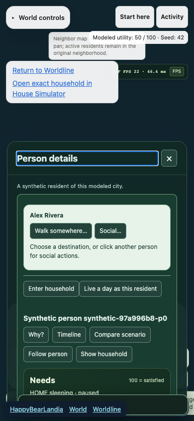

# SHE-27 browser gate repair

The hosted Ubuntu24.04 pilot installed Chromium successfully and exposed three
release-browser failures. All three reproduced locally before edits. The user
explicitly transferred this bounded World/browser repair to the pilot coordinator.

Saved-future exits were inside collapsed World controls, which resident selection
closes. The navigation now stays independently reachable beside the resident panel;
journeyURL and exact experiment/resident/household context remain unchanged. A
first candidate exposed pointer obstruction by the desktop person panel, retained
as a failed verification; moving the navigation to the left corrected it.

The browser suite now verifies actual Canvas2D fallback on a390px phone and a
separate total-graphics-failure return path. Both must return to the exact saved
experiment/person at minute360. Directory verification compares every rendered
experience ID to the source registry instead of a stale29-entry count. No suite
is skipped and no model, saved-record or frozen Future Machine interface changes.

Verification on2026-11-12 UTC:

- Exact core workflow unit command:81 pass,0 fail,833 assertions.
- Four focused normal/fallback/fatal/directory journeys:4 pass,28.6s.
- Complete release-browser configuration:13 pass,39.9s.
- Phone screenshot captured from the real saved-checkpoint Canvas2D path and
  visually inspected; synthetic model data only.
- Hosted follow-up CI remains pending push; do not treat local checks as Linux
  acceptance or production verification. No merge or deployment.

