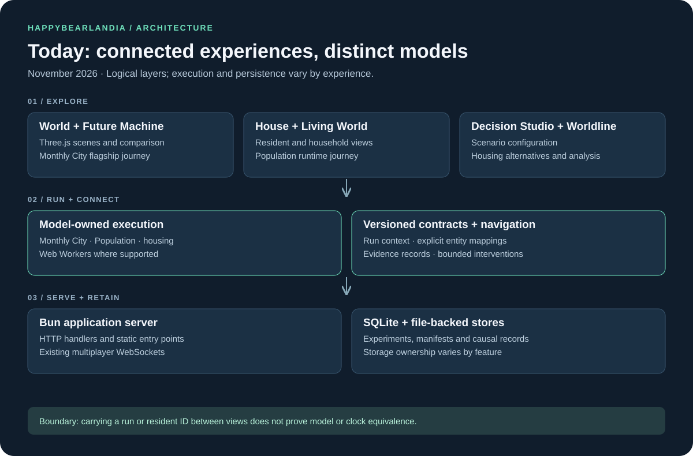
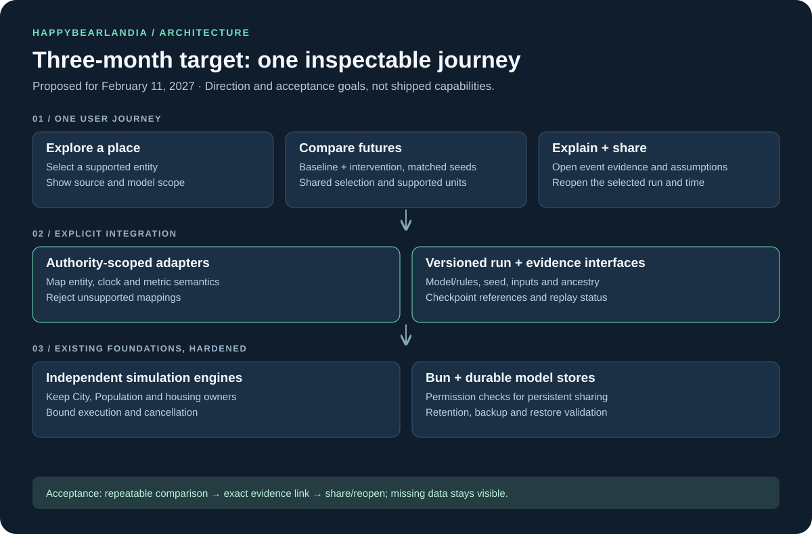

# HappyBearLandia 🐻

**Explore a place. Change an assumption. See how its future changes—and inspect why.**

HappyBearLandia is a simulation playground for cities, households, businesses, and alternative futures. It combines interactive worlds with repeatable experiments: propose a change, compare it with a baseline, follow the evidence, and share a scenario someone else can reopen.

Real geography, synthetic model outputs, and story interpretation have different roles here. A modeled future is an experiment under declared assumptions, rather than a prediction of what will happen.

## Start with one city, two futures

The flagship **Future Machine** compares a synthetic Riverside city with and without a housing proposal over 120 modeled months. Scrub both futures together, inspect construction and spending, and open the records behind a change.

The default scenario produces **36 baseline homes versus 60 plan homes**, with **1,000,000 illustrative USD** in additional cumulative capital spending. These are results of the versioned synthetic scenario. Its scene is schematic; it does not assign those outcomes to real geographic parcels.

## Run locally

Install [Bun](https://bun.sh/), then run from the repository root:

```sh
bun install
bun run start
```

Open **http://localhost:3000** and choose **Play Demo**, or go directly to **http://localhost:3000/world/future-machine.html**. Set `PORT` to use another port.

The synthetic demo is the best starting point. Features using live geography or external providers have additional service and configuration requirements; consult their module documentation. Local execution can create SQLite databases and saved files. Storage configuration and backup procedures are documented in [release operations](docs/release-operations.md) and [Future Machine storage](docs/future-machine-storage.md).

### Live map configuration

Bun loads the repository's `.env` automatically. For live map requests, set
`OVERPASS_URL` to a reachable Overpass interpreter endpoint and optionally set
`OVERPASS_TIMEOUT_MS=15000`. The available example is [`.env.example`](.env.example);
merge the settings into an existing `.env` rather than replacing it.

Check `/api/overpass-health` for connectivity and
`/api/area?lat=40.7265&lng=-73.9815` for an area response. A response with
`"source":"osm"` indicates sourced map data. Provider availability can vary.

## Explore the application

Paths below are relative to your running local server.

| Experience | Local path | What to try |
| --- | --- | --- |
| Future Machine | `/world/future-machine.html` | Compare the housing futures, scrub time, inspect a change, and share a recipe. |
| Living World | `/world?living=1` | Explore simulated residents, households, schedules, and needs. |
| House Simulator | `/world/house` | Inspect a household; supported saved-resident journeys retain Population identity. |
| Decision Studio | `/world/decision.html` | Configure alternatives and examine housing-model outcomes. |
| Worldline | `/tools/worldline` | Explore outcomes under different assumptions. |
| City Laboratory | `/world/city-lab.html` | Run experiments with the monthly City model. |
| FlowMap | `/tools/flowmap` | Explore synthetic supply-chain disruptions and rerouting. |

The homepage also contains the broader catalog of games, tools, and experiments. These experiences have different levels of integration; a navigation link alone does not establish shared simulation state.

## Architecture today



The application uses **Bun and JavaScript modules**, **Three.js**, **Web Workers**, and **SQLite plus file-backed persistence**. Some interfaces use React; existing multiplayer surfaces use WebSockets.

Three important simulation authorities coexist: **monthly City**, **World Population**, and **Decision Studio housing**. Each owns its state, identifiers, and clock. Shared contracts describe run context, provenance, metrics, and supported interventions. Cross-view integration requires an explicit mapping; equal local IDs are insufficient.

Replay also has distinct meanings. Future Machine currently reconstructs detailed history from a stored manifest. Determinism is tested, but that reconstruction is not independently verified equivalence to recorded checkpoints. See the [Future Machine handoff](docs/future-machine.md) for assumptions and limitations.

## Architecture three months from now

**Proposed target: February 11, 2027.** This is an architectural direction based on the product design, not a delivery commitment or a claim that these integrations already exist.



The priority is a complete journey through the existing foundations. Keep model ownership explicit while making supported comparisons, selections, and evidence easier to follow across views.

| Window | Focus | Evidence of completion |
| --- | --- | --- |
| Month 1 | Consolidate the flagship journey | Normal-entry tests cover comparison, event inspection, missing data, and share/reopen. Record reproducibility inputs and measure replay cost. |
| Month 2 | Integrate one supported cross-view slice | Document entity, time, and metric mappings for one model pair. Verify that selection and evidence survive navigation and reload; unsupported mappings remain explicit. |
| Month 3 | Harden persistence and sharing | Validate ownership and access rules where sharing requires them, retention, isolated backup restoration, and device/network limits. Keep recorded and recomputed replay labels accurate. |

The first prerequisite for cross-model work is proving the mapping. Public persistent sharing additionally depends on authorization, durability, and operational checks. Detailed feature status remains in the [implementation plan](docs/implementation-plan.md); the target diagram does not override it.

## Find your way through the code

| Location | Responsibility |
| --- | --- |
| [`server.js`](server.js) | Bun server, application routes, API composition, and static serving. |
| [`world/future-machine/`](world/future-machine/) | Flagship comparison data, scene, UI, story, and sharing. |
| [`world/city/`](world/city/README.md) | Monthly City engine and coupled system contracts. |
| [`world/universe/`](world/universe/README.md) | Experience registry and contextual navigation. |
| [`shared/causality/`](shared/causality/README.md) | Shared identity, run, metric, provenance, and intervention contracts. |
| [`world/replay/`](world/replay/README.md) | Replay infrastructure and verification contracts. |
| [`world/counterfactual/`](world/counterfactual/README.md) | Fork execution, dependency handling, and bounded interventions. |
| [`test/`](test/) | Behavior, integration, and browser checks. |
| [`tools/`](tools/) · [`game/`](game/README.md) · [`blog/`](blog/README.md) | Additional experiences, physics playground, and publishing. |

## Verify a change

Run the checks for the affected slice. A small starting set for the simulation foundations is:

```sh
bun test test/causality-contracts.test.js test/counterfactual-fork.test.js test/bakery-journey.test.js
```

Other existing entry points include:

```sh
bun run test:city
bun run test:decision
bun run test:build-world
```

Browser suites use Playwright. Install Chromium once, then run a focused journey:

```sh
bunx playwright install chromium
bunx playwright test --config test/future-machine.browser.config.js
```

These are focused checks, not a claim that every experience passes. Consult the relevant test configuration for server and environment requirements. The package currently has no default `test`, lint, or repository-wide typecheck script; individual modules document additional checks.

## Design and contribution

Start with the [product design](docs/design.md), [implementation plan](docs/implementation-plan.md), and [engineering instructions](AGENTS.md). Finish a tested journey through the normal application entry points before broadening a substantial feature.

Preserve seeds, model and rules versions, inputs, provenance, and parent-run history. Keep observations, assumptions, modeled results, and narrative interpretation distinguishable. Document uncertainty and missing evidence alongside the result.

For deployment and persistence work, use the [release checklist](docs/release-checklist.md) and [release operations](docs/release-operations.md). Local test success is only one part of release readiness.

Earlier sketches and references are preserved in the [original README notes](docs/original-readme-notes.md). These are historical ideas, not current feature documentation.

Social simulation rules and reproduction boundaries are documented in the [ODD model inventory](docs/models/README.md). Model changes require code-to-description review before approval.
