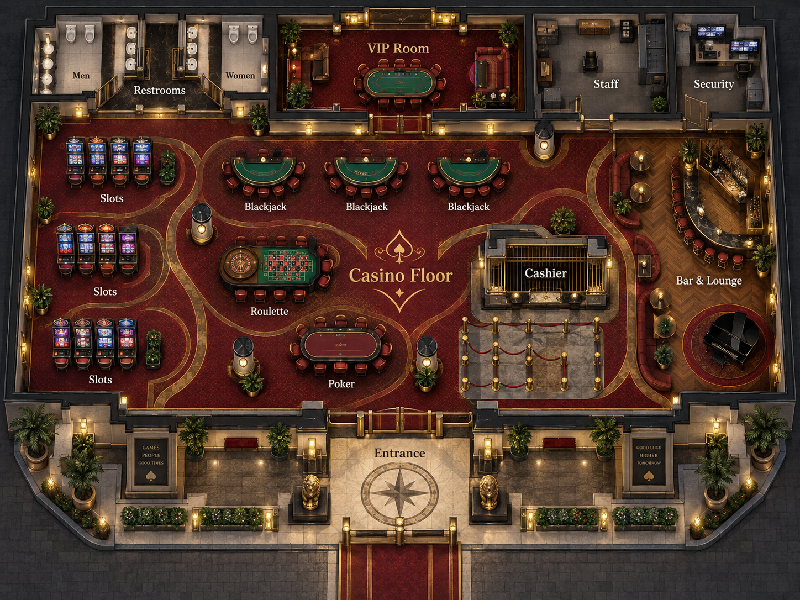

# Grattitude game
# HappyBearLandia - VR/AR Game Studio for Education

# Computer Vision for Beginners

simulators, games, tools, robots

this repo has a physics puzzle game that makes data for machine learning

# Usage instructions

how to run application locally

\`bun run dev\`

how to run augmented reality locally

op run --env-file=.env.op -- bun scripts/fs-sync-mediapipe.ts

## /game
## /edit (Augmented_reality)
## /pick-and-place multiplayer_robots
## /inference
## /training
## /data

# hardware 
https://www.hiwonder.com/products/nexarm6-axis

- 5 minutes stream per day
fswebcam -r 1920x1080 --no-banner image.jpg
ffmpeg -f v4l2 -framerate 30 -video_size 1920x1080 \
-i /dev/video0 \
-t 5 \
-c:v libx264 \
-preset veryfast \
output.mp4
HappyBearLandia/
  webcam/
    2026-09-11/
      00-00.mp4

# how to run locally
bun run start

## World map `.env` setup (recommended)

Bun auto-loads `.env` from the project root, so you can configure world map connectivity once:

1. Copy the template:
   `cp .env.example .env`
2. Edit `.env` and set a reachable Overpass endpoint:
   - `OVERPASS_URL=https://<reachable-host>/api/interpreter`
   - `OVERPASS_TIMEOUT_MS=15000`
3. Start server:
   `bun server.js`
4. Validate connectivity:
   - `/api/config` shows active runtime config (safe fields only)
   - `/api/overpass-health` should show `reachable: 1+`
   - `/api/area?lat=40.7265&lng=-73.9815` should return `"source":"osm"` when reachable

# how to deploy

fly deploy

# references
- https://www.youtube.com/watch?v=4Tr0otuiQuU&list=RD4Tr0otuiQuU&start_radio=1
- https://github.com/jhuckaby/canvascycle
