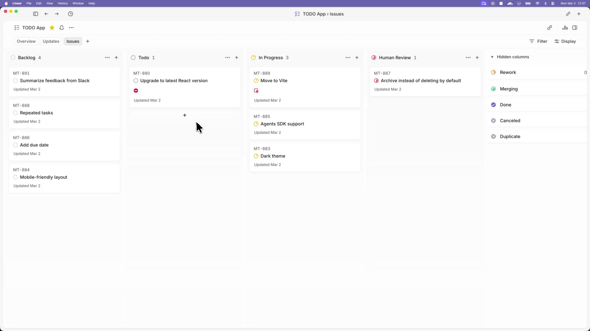

# Symphony

HappyBearLandia pilot: GitHub publication runs in the trusted host `after_run`
hook after a sandboxed local commit. See [the pilot runbook](local/README.md) for the JSON handoff,
Keychain prerequisite, offline tests, exact launch command and host-only retry.
The agent does not push or handle GitHub credentials.

Symphony turns project work into isolated, autonomous implementation runs, allowing teams to manage
work instead of supervising coding agents.

_In this [demo video](https://player.vimeo.com/video/1186371009?h=5626e4b899), Symphony monitors a Linear board for work and spawns agents to handle the tasks. The agents complete the tasks and provide proof of work: CI status, PR review feedback, complexity analysis, and walkthrough videos. When accepted, the agents land the PR safely. Engineers do not need to supervise Codex; they can manage the work at a higher level._

> [!WARNING]
> Symphony is a low-key engineering preview for testing in trusted environments.

## Running Symphony

### Requirements

Symphony works best in codebases that have adopted
[harness engineering](https://openai.com/index/harness-engineering/). Symphony is the next step --
moving from managing coding agents to managing work that needs to get done.

### Option 1. Make your own

Tell your favorite coding agent to build Symphony in a programming language of your choice:

> Implement Symphony according to the following spec:
> https://github.com/openai/symphony/blob/main/SPEC.md

### Option 2. Use our experimental reference implementation

Check out [elixir/README.md](elixir/README.md) for instructions on how to set up your environment
and run the Elixir-based Symphony implementation. You can also ask your favorite coding agent to
help with the setup:

> Set up Symphony for my repository based on
> https://github.com/openai/symphony/blob/main/elixir/README.md

---

## License

This project is licensed under the [Apache License 2.0](LICENSE).

## HappyBearLandia local pilot

The local Linear configuration in `elixir/WORKFLOW.md` is opt-in via the
`symphony-pilot` label and runs one worker. It uses independent clones, parks
blocked work outside review, and hands off validated draft PRs against the sprint
branch for human review. See [local procedures](local/README.md) before running;
the older ops supervisor is not this pilot's entry point.

HappyBearLandia pilot: trusted host hooks initialize the Linear workpad before Codex and consume local status updates afterward; see [local runbook](local/README.md). Missing workpads are host initialization work.
